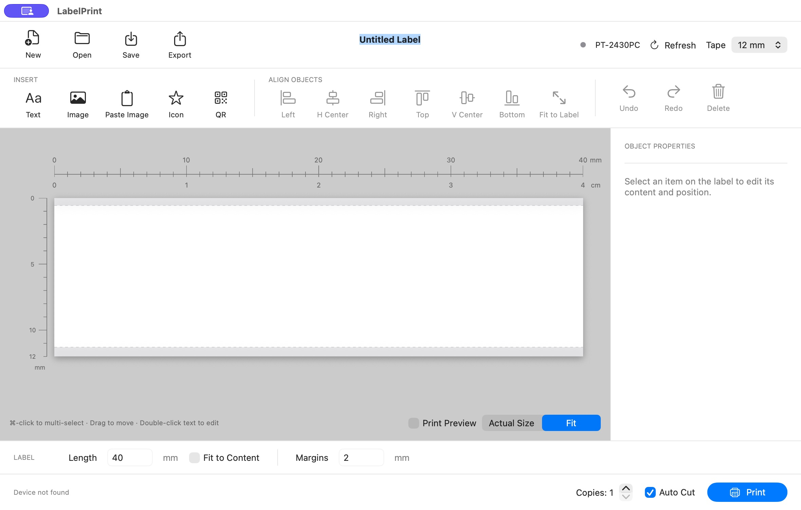

# LabelPrint

A native macOS label editor for the **Brother PT-2430PC**, built with SwiftUI and a directly linked Rust USB backend.

## Features

- Start with a blank 40 × 12 mm label; select tape width, fixed length or automatic Fit to Content.
- Add text, QR codes, images and macOS symbols. Edit text directly on the label with character selection and installed-font previews.
- Change font, size, bold, italic and text alignment. Paste images from the clipboard, convert them to grayscale and trim blank borders.
- Move and resize objects with mm/cm rulers, gray unprintable areas, alignment guides and edge/center snapping.
- Command-click for multiple selection. Align, duplicate, delete, undo/redo, or Fit to Label while preserving proportions.
- Save/open labels with embedded images and export print-ready PNG files.
- Print directly over USB with tape-width validation, copies and Auto Cut; no helper server or Brother driver is required.
- Smooth grayscale editing preview and an exact monochrome Print Preview. Error diffusion retains image tones within the printer's 180 dpi limits.

## License

LabelPrint is open source under **GNU GPL-3.0-or-later**. See [LICENSE](LICENSE) and [NOTICE](NOTICE). You may use, study, modify and redistribute it under that license; distributed combined binaries require corresponding source through a GPL-compliant distribution method. No warranty is provided.

The app links [ptouch-rs / ptouch-core](https://github.com/vowstar/ptouch-rs), also GPL-3.0-or-later, with local PT-2430PC pre-cut and zero-feed fixes. Third-party components retain their own notices in [ThirdPartyNotices](ThirdPartyNotices/), including the LGPL-2.1-or-later libusb C library. macOS system fonts and SF Symbols are resolved at runtime; font files are not bundled.
