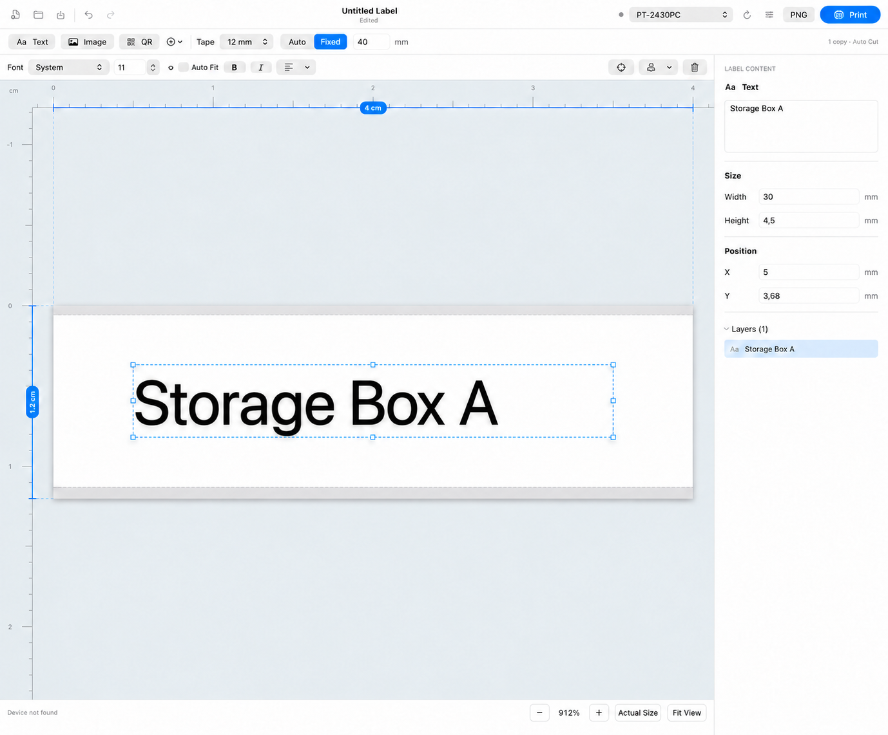
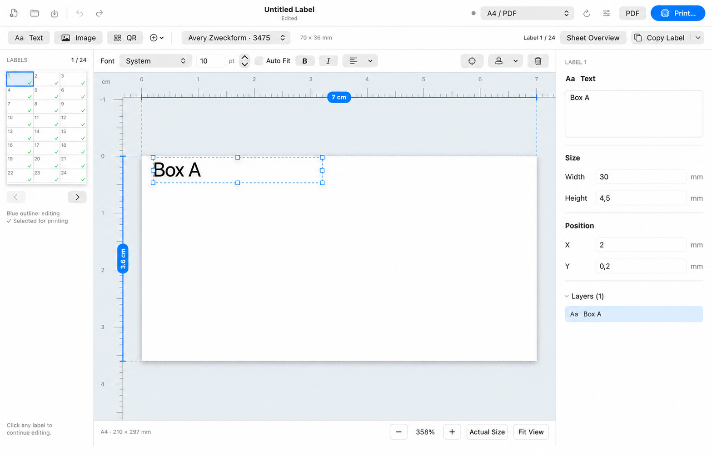

# LabelPrint

**Design a label once, then print it on Brother PT-2430PC tape or an A4 label sheet.** LabelPrint is a native macOS editor that combines direct text editing, physical-size rulers and independent sheet labels in one workspace.

- **Tape labels:** choose tape width and length, edit your artwork, and print directly over USB with copies and Auto Cut. No Brother driver or helper server is required.
- **A4 sheets:** choose an Avery Zweckform template, copy a design to multiple positions, and export an actual-size PDF or print through macOS.
- **Precise editing:** edit text on the canvas, resize images with a ratio lock, and use millimetre measurements, alignment tools and undo/redo.

Requires **macOS 14 or later**. Tape printing supports the **Brother PT-2430PC**; A4 printing uses a configured macOS printer queue.

## See the workspace

### PT-2430PC: edit and print a tape label

Tape width and length sit beside the insert tools. Text formatting stays above the canvas; content, dimensions and position stay in the right inspector. Blue size markers sit directly on the rulers.



### A4: move between labels without losing your place

The left sheet navigator shows the current label and print positions. Edit one label at a larger scale, switch to another, or return to the whole sheet with **Sheet Overview**.



## Make your first label

### Print on PT-2430PC tape

1. Connect the printer by USB and select **PT-2430PC**.
2. Choose **Tape** width: 6, 9, 12, 18 or 24 mm. New documents start at **40 × 12 mm**. Choose **Fixed** length or **Auto** to fit the content; the minimum label length is **25.4 mm**.
3. Click **Text** and type immediately, or insert an image, QR code or macOS symbol. Adjust formatting above the canvas and dimensions in the inspector.
4. Open **Print settings** to set copies, Auto Cut and print preview options. Use **PNG** to export the tape artwork, or **Print** to send it to the printer.

### Print on an A4 sheet

1. Select an A4 system printer, or **A4 / PDF** to prepare a sheet without a physical printer.
2. Choose a template. Click a label to focus it; double-click text to type directly. Use the left navigator to continue editing other labels at the same zoom.
3. Use **Copy Label** to copy the current design to selected destinations, or copy to all empty labels. Each copy can be edited independently.
4. In **Print settings**, choose the positions to print and the paper stock. For plain paper, enable light dashed cut lines to help with trimming.
5. Export **PDF** first to check dimensions and placement. Print on A4 at **Actual Size / 100%**; avoid Fit to Page. Use X/Y offsets in Print settings if the printer needs alignment calibration.

**Copy destinations and print positions are separate.** A blue outline marks the label being edited; green checks mark positions selected for printing. Copying a design does not change the print selection.

## Editing tools

| Task | Controls |
| --- | --- |
| Edit text | Click Text to start typing; double-click existing text or press Enter on a selected text object. Choose font, size, Auto Fit, bold, italic and alignment above the canvas. |
| Adjust an image | Paste or insert an image, replace it while preserving its frame, trim blank borders, or crop manually. Lock the aspect ratio to update width and height together. |
| Position artwork | Drag objects, use eight resize handles, enter dimensions and X/Y in mm, or center on the label in one action. Edge/center snapping and temporary guides help alignment. |
| Work with several objects | Command-click to select multiple objects; align, duplicate or delete them together. Use the layer list to select overlapping objects. |
| Inspect the canvas | Scroll to zoom around the pointer. Rulers span the canvas, show cm with mm ticks, and include negative coordinates before the origin. |
| Check tape output | Switch between smooth editing preview and the exact monochrome **Exact Printer Bitmap** preview. Error diffusion retains image tones within the printer’s 180 dpi output. |
| Save and revise | Save/open `.label.json` documents with embedded images. A4 documents preserve individual labels and print positions. Text-edit sessions and batch label copies each undo in one step. |

## A4 templates and output dimensions

A4 export uses a **210 × 297 mm portrait PDF**. Only rectangular labels with square corners are supported.

| Template | Label size | Columns × rows | Left / top margin |
| --- | --- | --- | --- |
| Blank A4 | 210 × 297 mm | 1 × 1 | 0 / 0 mm |
| Avery Zweckform 3475 | 70 × 36 mm | 3 × 8 | 0 / 4.5 mm |
| Avery Zweckform 3474 | 70 × 37 mm | 3 × 8 | 0 / 0 mm |
| Avery Zweckform 3652 | 70 × 42.3 mm | 3 × 7 | 0 / 0 mm |

These templates have no gaps between labels. Plain-paper cut lines are optional; pre-cut label stock does not print them. One document contains one sheet design, which can be repeated using the sheet count in Print settings.

Canvas zoom affects only the editor. Final placement also depends on the printer’s hardware margins and print-dialog scaling; use the exported PDF and a 100% test print to check a new printer or stock.

## Build and run

Development requires a Swift 6 toolchain, Rust/Cargo with edition 2024 support, and the macOS SDK from Xcode or Command Line Tools. The app uses SwiftUI with a directly linked Rust USB backend; libusb is built from vendored source.

```sh
# Build and run the editor
./scripts/build.sh
.build/debug/LabelPrint

# Build a standalone, ad-hoc-signed macOS app
./scripts/package.sh
open docs/releases/LabelPrint.app

# Run the automated checks
./scripts/test.sh
```

The packaged app is written to `docs/releases/LabelPrint.app`. The `docs/`, `.build/` and cache directories contain local artifacts and are ignored by Git. README screenshots are stored in `assets/` so they remain available in a source checkout.

## License

LabelPrint is open source under **GNU GPL-3.0-or-later**. See [LICENSE](LICENSE) and [NOTICE](NOTICE). You may use, study, modify and redistribute it under that license; distributed combined binaries require corresponding source through a GPL-compliant distribution method. No warranty is provided.

The app links [ptouch-rs / ptouch-core](https://github.com/vowstar/ptouch-rs), also GPL-3.0-or-later, with local PT-2430PC pre-cut and zero-feed fixes. Third-party components retain their own notices in [ThirdPartyNotices](ThirdPartyNotices/), including the LGPL-2.1-or-later libusb C library. macOS system fonts and SF Symbols are resolved at runtime; font files are not bundled.
